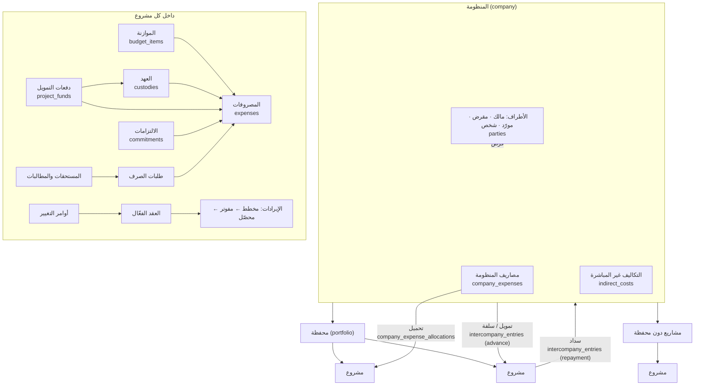

# التحليل الشامل: توحيد البيانات، والربط بين المنظومة ومشاريعها، والمنظومة المالية

> أُعدّ من الكود الفعلي في هذا المستودع بتاريخ 15 نوفمبر 2026. كل رقم وملف هنا مأخوذ مما هو موجود الآن، وما ليس موجوداً مذكور صراحة كـ«فجوة».

## 1. الهيكل: المنظومة ومحافظها ومشاريعها والأطراف

**قاعدة الانتماء الواحدة:** المشروع ينتمي لشركته بـ`companyId`، وتُحسب أرقامه فيها مرة واحدة أينما وُضع (صُحّح في هذا الفرع: كان المشروع تحت محفظة محذوفة يسقط من المجاميع). قاعدة البيانات تمنع وضع مشروع في محفظة شركة أخرى (`project_placement_guard`).

## 2. مصدر كل رقم (المصدر الواحد)

| الرقم | الدالة الوحيدة | الملف |
|---|---|---|
| المصروف المحسوب (بلا مرفوض ولا سلفة قائمة) | `getCountedExpenses` | `src/lib/finance/summary.ts` |
| المحصّل · المفوتر غير المحصّل · المفوتر | `getCollectedRevenue` · `getOutstandingInvoiced` · `getBilledRevenue` | `summary.ts` |
| ملخص المشروع (العقد الفعّال، الموازنة، الربح المخطط والمحقق) | `getProjectSummary` | `summary.ts` |
| المحفظة والشركة | `getPortfolioSummary` · `getCompanySummary` | `src/lib/portfolio.ts` |
| صافي المنظومة بعد مصاريفها | `companyNet` | `company-net.ts` |
| التمويل والسداد بين المنظومة والمشروع | `fundingByProject` · `balancesWithCompany` | `loans.ts` · `company-ledger.ts` |
| القروض ومواعيدها | `loansByLender` · `dueLoans` | `loans.ts` |
| حالة المشروع (✓ ▲ ✕ ○) | `healthOf` | `company-map.ts` |
| الكشف الشهري الموحّد | `buildUnifiedStatement` | `unified-statement.ts` |
| التدفق النقدي المتوقع | `getCashFlowForecast` | `cashflow.ts` |
| سلامة الدفاتر | `checkIntegrity` | `integrity.ts` |

البوابة `scripts/ssot-guard.sh` تُفشل البناء إن نُسخت قاعدة المصروف المحسوب أو مجاميع الإيراد يدوياً.

## 3. ما وُجد من تكرار وفجوات

| # | الملاحظة | الأثر | الحالة |
|---|---|---|---|
| 1 | 30 عملية جمع مبالغ مكتوبة يدوياً داخل 20 مكوّناً (مثل `BudgetSection`، `FundsSection`، `RevenueSection`، `CashLedgerSection`) | معظمها جمع لمجموعة مفلترة مسبقاً وليس قاعدة مال، لكن كل واحدة قابلة للانحراف | **مفتوحة**: تُراجع واحدة واحدة وتُنقل الصالحة منها لدوال في `lib/finance` مع توسيع البوابة |
| 2 | مشروع تحت محفظة محذوفة أو لشركة أخرى يسقط/يُكرَّر في المجاميع | مجموع الشركة لا يساوي مشاريعها | **أُغلقت** في هذا الفرع |
| 3 | دفتر المنظومة خارج فحص السلامة | تحميل زائد أو مشروع منتهٍ مدين لا يظهران | **أُغلقت** |
| 4 | لا قائمة دخل (P&L) رسمية بفترة | الربح يظهر مخططاً أو محققاً للمشروع كله، لا لفترة | **فجوة** |
| 5 | التدفق النقدي توقّع من الموازنة، لا قائمة فعلية بالطريقة المباشرة | لا يُرى ما دخل وخرج فعلاً شهراً بشهر على مستوى المنظومة | **فجوة** |
| 6 | لا «أعمار» للذمم: المفوتر غير المحصّل والسلف القائمة بلا توزيع زمني (0–30، 31–60، 61–90، +90) | المتأخر يختلط بالجديد | **فجوة** |
| 7 | الالتزامات (`commitments`) تُعرض في المشروع ولا تدخل «المتبقي الحقيقي» على مستوى المنظومة | الموازنة تبدو أوسع مما هي | **فجوة** |
| 8 | فلاتر لوحة التحكم لا تحكم كل الأقسام (قسم «المنظومات» بأرقام المشروع كله) | قراءتان مختلفتان في صفحة واحدة | **فجوة مقصودة الآن**، تُحسم بنظام الفلاتر الموحّد |

## 4. المنظومة المالية المستهدفة (وفق الممارسات المعتمدة)

المرجع: فصل **الاستحقاق عن النقد** (IFRS / المعايير السعودية)، والتدفق النقدي **بالطريقة المباشرة** (IAS 7)، وإدارة المحافظ **بالقيمة المكتسبة** (PMI / ISO 21508)، ولوحات **الاستثناء أولاً**.

| القائمة | ما تجيب عنه | مصدرها |
|---|---|---|
| **قائمة الدخل (P&L)** لفترة، لكل مشروع ومحفظة ومنظومة | إيراد مفوتر − تكلفة مباشرة = مجمل الربح؛ − المحمَّل من المنظومة − غير المباشر = صافي الربح | `getBilledRevenue` + `getCountedExpenses` بتاريخ + `summarizeCompanyExpenses` + `indirect_costs` |
| **قائمة التدفق النقدي** بالطريقة المباشرة | ما دخل فعلاً (تحصيل، تمويل، قروض) وما خرج (صرف، سداد) شهراً بشهر، والرصيد | الإيرادات بتاريخ التحصيل + المصروفات + `intercompany_entries` |
| **الذمم والسلف** بأعمارها | من عليه لمن، ومنذ متى | `getOutstandingInvoiced` + السلف القائمة + `balancesWithCompany` |
| **الالتزامات** | ما تعاقدنا عليه ولم يُصرف بعد | `commitments` |
| **المتبقي الحقيقي** | الموازنة − المصروف − الالتزامات | التجميع |

## 5. نظام الفلاتر الموحّد

فلتر واحد في رابط الصفحة يحكم كل الأقسام: **المنظومة · المحفظة · المشروع · الحالة · الفترة (من–إلى أو شهر/ربع/سنة) · العملة · الأساس (استحقاق/نقدي)**. كل قسم يقرأ الحالة نفسها، ويُحفظ الرابط فيُشارَك كما هو. الفترة تحكم قوائم الدخل والتدفق؛ ونِسَب الموازنة تبقى للمشروع كله ويُكتب ذلك بجانبها.

## 6. خارطة التنفيذ (كل مرحلة PR مستقل يمر بالبوابات الثماني)

1. **محرك القوائم:** `src/lib/finance/statements.ts` فيه `incomeStatement(scope, period)` و`cashFlowStatement(scope, period)` و`agingOf(...)`، مبنية على الدوال أعلاه فقط، مع اختبار مطابقة يثبت أن مجموع المشاريع = المحفظة = المنظومة، ورصيد التدفق = الافتتاحي + الداخل − الخارج.
2. **نظام الفلاتر الموحّد** في الرابط، وتطبيقه على لوحة التحكم كلها.
3. **لوحة التحكم المالية:** شريط مؤشرات (صافي الربح، النقد، الذمم المتأخرة، الالتزامات)، وقائمة دخل وتدفق نقدي بالأشهر، وأعمار الذمم، والاستثناءات أولاً؛ بالوضعين الفاتح والداكن وبرموز لا بألوان وحدها.
4. **هيكلة المنظومة المرسومة** تفاعلياً: المنظومة ← المحافظ ← المشاريع، بخطوط تمويل وسداد بسماكة المبلغ.
5. **إغلاق التكرار:** نقل عمليات الجمع اليدوية الصالحة إلى `lib/finance` وتوسيع `ssot-guard`.
